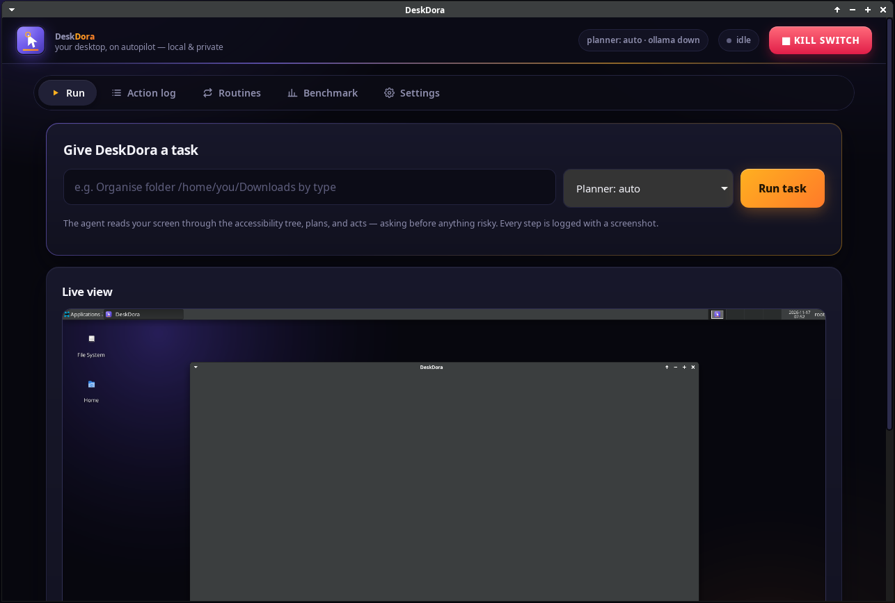

<p align="center"></p>

# DeskDora

**Local-first desktop agent for Linux (Ubuntu/GNOME): accessibility-tree grounding with vision fallback, Ollama-powered planning, a mandatory-confirmation safety layer, and a complete audit log of every action.**

DeskDora operates your desktop for you. You type a task in plain words —
*"Organise folder ~/Downloads by type"*, *"Fill the form: name=…, email=…,
city=… and submit"* — and DeskDora does the clicking and typing itself:
opening apps, pressing buttons, filling fields, reading pages back to you.

It is **local-first**: planning runs on your machine (a local model via
Ollama, or a built-in deterministic planner that needs no model at all).
Your screen never streams to a cloud service, because there isn't one.



## Why it works (and when it doesn't)

Most computer-use agents guess pixels from screenshots and misclick
constantly. DeskDora doesn't guess: it reads the desktop through the
operating system's **accessibility tree (AT-SPI)** — every window, button,
text field and menu as a numbered, labelled element — and the planner
picks an element, the same trick that made browser automation reliable.
A vision path (screenshot + OCR / vision model) exists as a fallback for
surfaces the tree can't describe.

DeskDora also **fails honestly**: if it cannot find an element, cannot
plan a goal, or a confirmation is denied, it stops and says why. It never
clicks randomly hoping something works.

## Safety is the product

An agent that can operate your whole PC can also delete your files. So:

- **Mandatory confirmation** before any action that deletes, sends,
  submits, or installs — in the web UI, a dialog blocks the run until
  *you* decide. This cannot be switched off.
- **Application allow-list** — restrict which apps the agent may launch.
- **Kill switch** — an always-visible button (and a stop file / signal)
  that halts the agent before its next step.
- **Complete audit log** — every run is recorded as structured JSONL
  with a screenshot per step, replayable in the UI. Nothing is invisible.
- **Sandbox mode** — run it inside a VM first (that's how we test it),
  let it earn your real machine later.

## Quick start (Ubuntu 22.04 / 24.04, GNOME, Xorg session)

**Easiest — the installable app (Ubuntu 24.04):**

```bash
sudo apt install ./deskdora_1.0.0_amd64.deb
```

Then launch **DeskDora** from your applications menu: it starts the local
service and opens the DeskDora application window (a native GTK window —
no browser involved). The package is self-contained — its Python
dependencies are bundled and installed into a private virtualenv, no
network needed beyond apt's own archives.
(Build it yourself with `packaging/build-deb.sh`.)

**From source:**

```bash
# System dependencies
sudo apt install python3-pyatspi python3-gi at-spi2-core xdotool scrot \
                 gir1.2-atspi-2.0 gir1.2-gtk-3.0 gir1.2-webkit2-4.1

# DeskDora itself
pip install deskdora        # or: pip install .  from a source checkout

# Optional: a local LLM planner
ollama pull qwen2.5:1.5b    # DeskDora works without it, too

# Run one task from the terminal
deskdora run "Organise folder ~/Downloads by type"

# Or start the web UI (local only, 127.0.0.1:8765)
deskdora serve
```

> **Session requirement:** v1.0 needs an **Xorg/X11 session** ("Ubuntu on
> Xorg" on the login screen). Wayland restricts the input injection and
> screen capture an agent lives on; proper Wayland support via desktop
> portals is the v1.1 milestone. Inside a VM, Xorg is a one-click choice.

## Planners

| Planner | What it is | When it's used |
|---|---|---|
| `ollama` | A local LLM (default `qwen2.5:1.5b`) writes a JSON step plan; every plan is validated against an action allow-list before anything runs | `deskdora run --planner ollama`, or auto mode when a server is reachable |
| `builtin` | A deterministic, rule-based planner with a small documented grammar (organise folders, settings toggles, form fills, article fact-finding, PDF→spreadsheet, open/click/type/press chains) | Offline, modest hardware, tests & benchmark |

The active planner is **recorded in every run log and shown in the UI** —
no silent substitution. Free-form goals the built-in planner can't parse
are refused honestly rather than improvised.

## Features (v1.0)

- Chat-style web UI with **live view**: watch the desktop, with the
  target element highlighted before each click
- Whole-desktop control: file manager, settings, browser, office apps,
  terminal — anything exposing an accessibility tree
- Hybrid grounding: accessibility tree first, vision fallback
- Safety layer: confirmations, app allow-list, sandbox mode, kill switch
- Audit log with before/after screenshots and step-by-step replay
- **Routines**: save a successful run and re-run it in one click,
  optionally on a cron schedule — stored locally, on your machine only
- **Benchmark**: 25 standard desktop tasks with end-state assertions;
  results published in [BENCHMARK.md](BENCHMARK.md), failures included

## Honest limits

- Xorg session required (Wayland = v1.1). GNOME is the reference
  desktop; other AT-SPI desktops (KDE, Cinnamon) are untested.
- Some widgets expose their rows poorly to the accessibility tree
  (certain icon views); tasks depending on those can fail — the agent
  reports the failure instead of working around it silently.
- The built-in planner understands a defined grammar, not arbitrary
  English. The Ollama planner handles free-form goals, but a small
  local model will plan imperfectly — plans are validated, and failed
  steps stop the run rather than cascade.
- Benchmark numbers come from a virtualised XFCE desktop standing in
  for GNOME (the reference rig); see BENCHMARK.md for exactly what ran.

## Development

```bash
python3 -m venv --system-site-packages .venv   # pyatspi is a system pkg
.venv/bin/pip install -e .[dev]
.venv/bin/pytest
deskdora bench          # full benchmark (needs a live X session)
```

## Licence

MIT — see [LICENSE](LICENSE). DeskDora is 100% original code.
