<p align="center"></p>

# DeskDora

**Local-first desktop agent for Linux (Ubuntu/GNOME) that controls your entire PC: accessibility-tree grounding, Ollama-powered planning that runs fully offline, optional cloud planners via your own API key, a phone companion on your local network, a mandatory-confirmation safety layer, and a complete audit log of every action.**

DeskDora controls your whole PC for you. You type a task in plain words —
*"Organise folder ~/Downloads by type"*, *"Fill the form: name=…, email=…,
city=… and submit"* — and DeskDora does the clicking and typing itself:
opening apps, pressing buttons, filling fields, reading pages back to you.

It runs **both ways — offline and online — and you pick, per task**.
It is **local-first**: by default, planning runs on your machine (a
local model via Ollama, or a built-in deterministic planner that needs
no model at all), and nothing leaves the machine by default. The
online paths are **opt-in**: cloud planners (v3.1) — if you
add your own API key for a provider and select it, your goal and a
text summary of your screen go to that provider, never otherwise and
never by default — and the phone companion (v3.0), which reaches
DeskDora over your local network only, behind a pairing PIN, with no
cloud relay and nothing routed through the internet. Local-first
means the choice is yours — the same app and the same safety layer
either way, never a separate "online version".

It is also **Linux-only** — that is the whole mission. Xorg/X11 is
the reference session; a Wayland driver exists through the desktop
portals. There are no macOS or Windows versions, and none are
planned: every driver in this project targets Linux desktops.

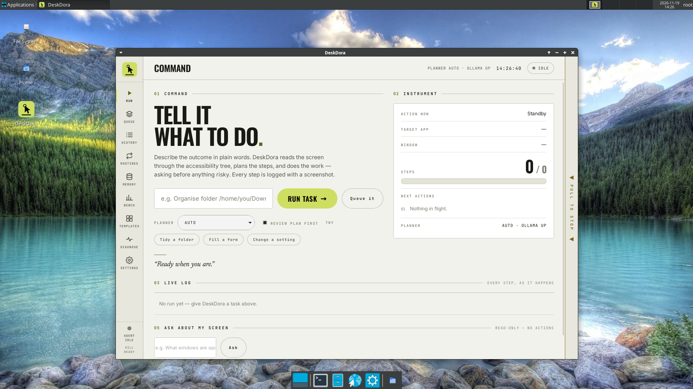

## See it in action

A complete run, start to finish — DeskDora launched from the
desktop, the setup wizard, and a folder organised end to end:

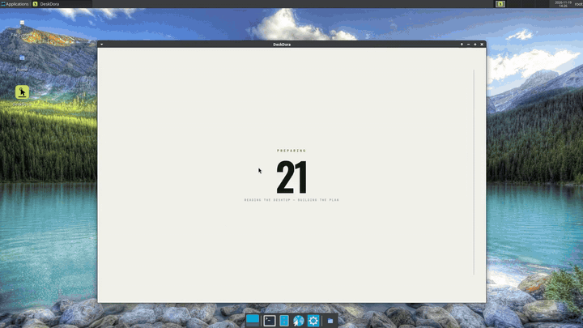

*The GIF above is the organise run itself. The full recording —
wizard, run and the WORK DONE finish — is
[here](docs/media/deskdora-demo.mp4) (4 min 37 s, no sound).*

### Screenshots

**The setup wizard's AI step** — the offline / online choice,
explained before you pick:

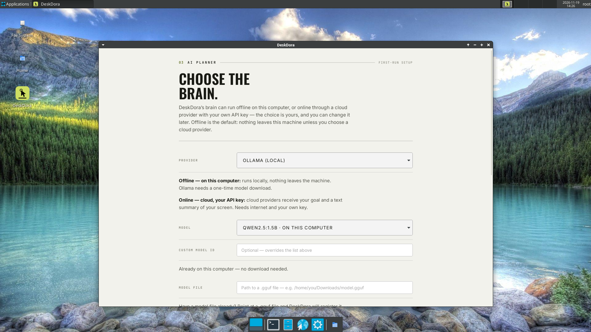

**A run in progress** — the activity feed stepping, the edge light
lit around the screen, the floating window in the corner:

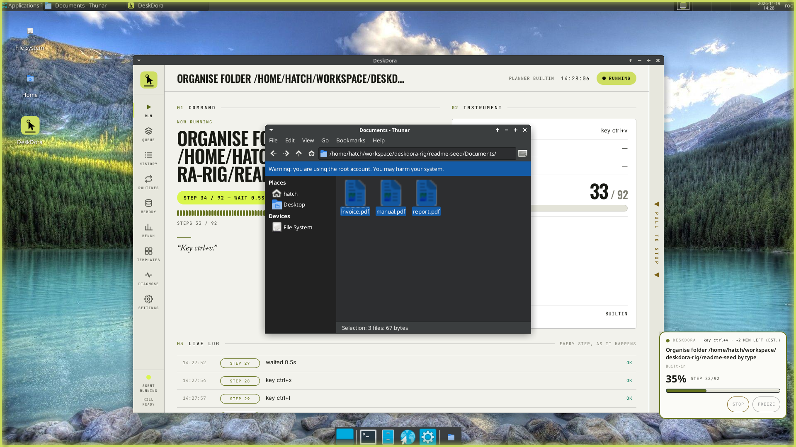

**Finished** — the WORK DONE card, with the step count and the time
it took:

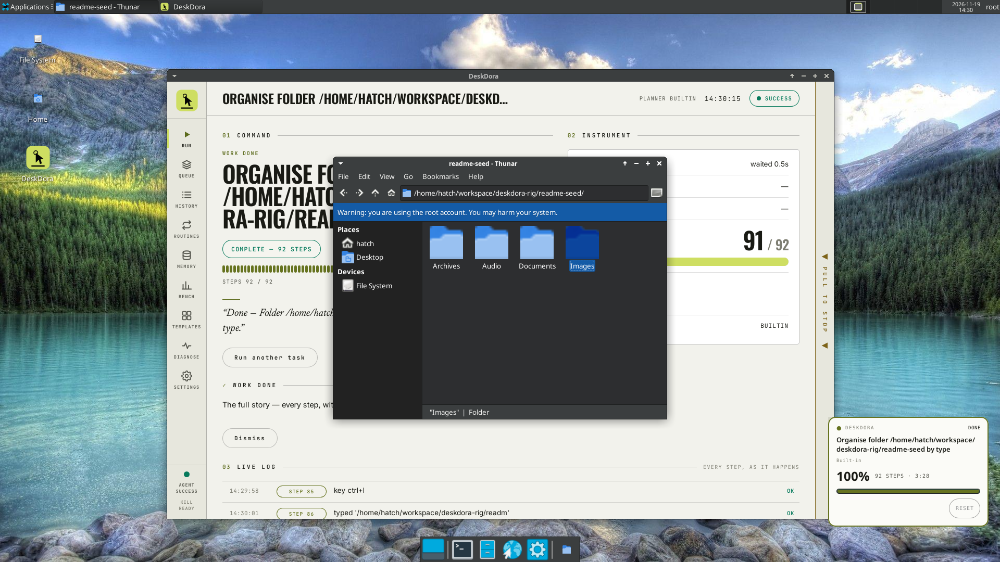

**Appearance** — light and dark themes, in Settings:

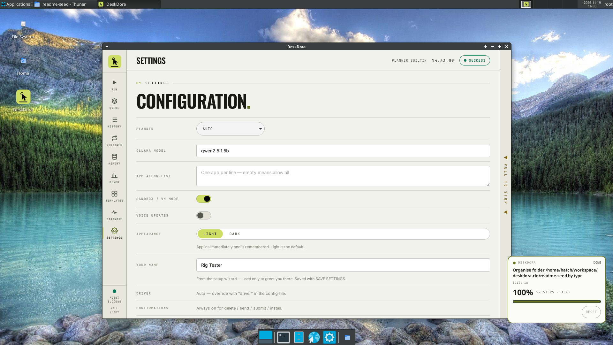

**Sounds** — every event with its own tone, picked and previewed in
Settings:

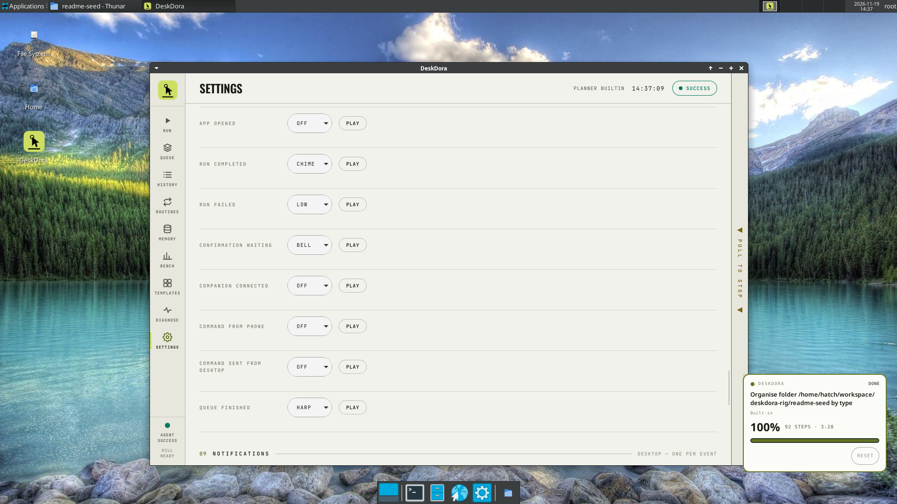

**History** — every past task as a thread you can reopen:

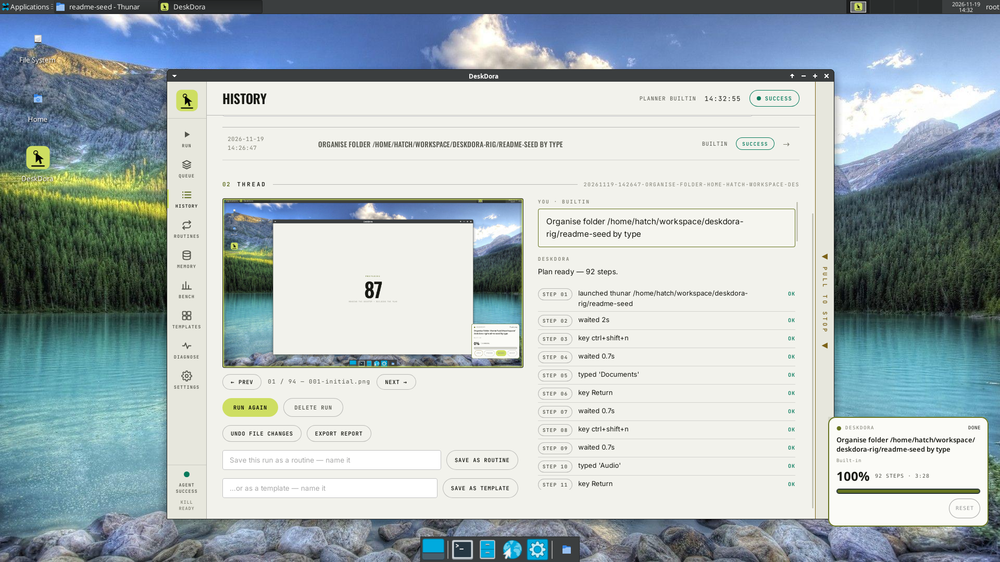

**Diagnostics** — this machine, measured live:

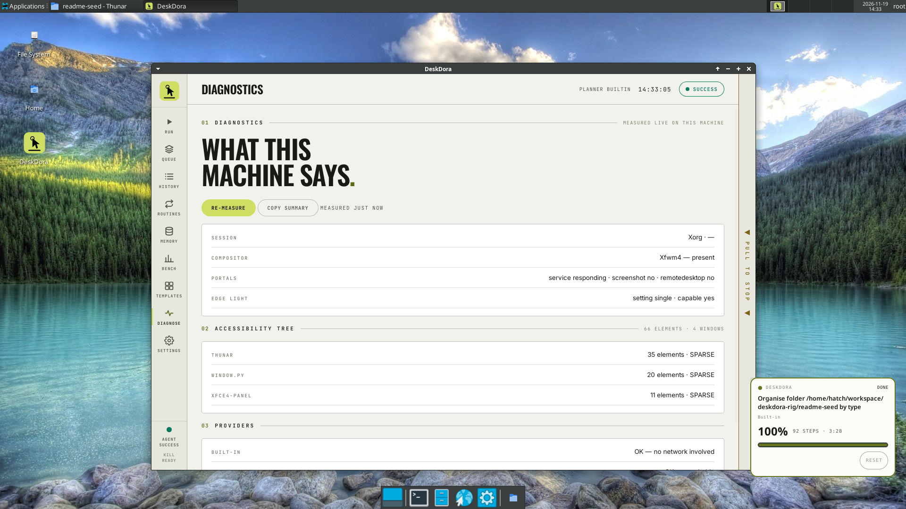

**Phone companion — live run** — the same agent, watched and
controlled from a phone on your local network: progress, step
count, and Freeze / Resume / Reset / Stop:

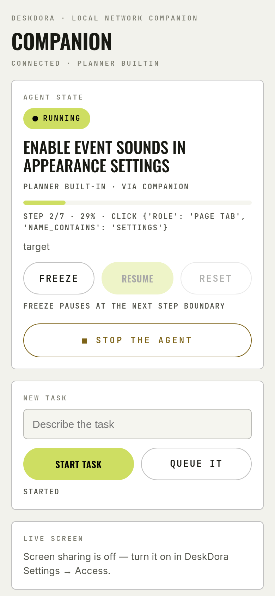

**Phone companion — confirmation** — a destructive step pauses
the run and asks on the phone first; nothing happens until you
tap Confirm:

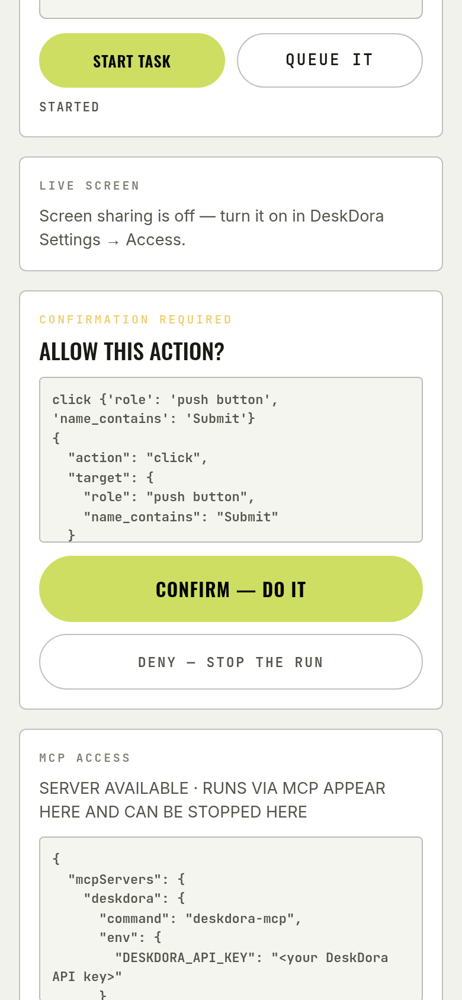

## Why it works (and when it doesn't)

Most computer-use agents guess pixels from screenshots and misclick
constantly. DeskDora doesn't guess: it reads the desktop through the
operating system's **accessibility tree (AT-SPI)** — every window, button,
text field and menu as a numbered, labelled element — and the planner
picks an element, the same trick that made browser automation reliable.
There is no vision fallback: a surface the tree can't describe is a
surface DeskDora cannot work with — and it reports that instead of
guessing (see Honest limits).

DeskDora also **fails honestly**: if it cannot find an element, cannot
plan a goal, or a confirmation is denied, it stops and says why. It never
clicks randomly hoping something works.

## Safety is the product

An agent that can operate your whole PC can also delete your files. So:

- **Mandatory confirmation** before any action that deletes, sends,
  submits, or installs — a dialog in the app blocks the run until
  *you* decide. This cannot be switched off.
- **Application allow-list** — restrict which apps the agent may launch.
- **Kill switch** — an always-visible button (and a stop file / signal)
  that halts the agent before its next step.
- **Complete audit log** — every run is recorded as structured JSONL
  with a screenshot per step, replayable in the UI. Nothing is invisible.
- **Sandbox mode** — run it inside a VM first (that's how we test it),
  let it earn your real machine later.

## Quick start (Ubuntu 22.04 / 24.04, GNOME, Xorg session)

**Easiest — the installable app (Ubuntu 24.04):** download
`deskdora_3.7.3_amd64.deb` from the
[Releases page](https://github.com/Abhisheklang/deskdora/releases),
then:

```bash
sudo apt install ./deskdora_3.7.3_amd64.deb
```

Then launch **DeskDora** from your applications menu: it starts the local
service and opens the DeskDora application window (a native GTK window —
no browser involved). The package is self-contained — its Python
dependencies are bundled and installed into a private virtualenv, no
network needed beyond apt's own archives.
(Build it yourself with `packaging/build-deb.sh`.)

**From source:**

```bash
# System dependencies
sudo apt install python3-pyatspi python3-gi at-spi2-core xdotool scrot \
                 gir1.2-atspi-2.0 gir1.2-gtk-3.0 gir1.2-webkit2-4.1

# DeskDora itself
pip install .               # from a source checkout (not on PyPI)

# Optional: a local LLM planner
ollama pull qwen2.5:1.5b    # DeskDora works without it, too

# Or go online instead — no local model needed: add your own API
# key for a cloud provider in Settings → AI Providers, select it,
# and planning runs online. Everything else stays the same.

# Run one task from the terminal
deskdora run "Organise folder ~/Downloads by type"

# Or start the service (127.0.0.1:8765 by default — add --host to
# serve the phone companion on your local network)
deskdora serve
```

> **Session support:** the reference session is **Xorg/X11** ("Ubuntu on
> Xorg" on the login screen), where DeskDora is developed and verified. A
> **Wayland driver** (v1.1) works through xdg-desktop-portal —
> AT-SPI perception, the Screenshot portal (with a ScreenCast/PipeWire
> fallback), and RemoteDesktop input where the compositor's portal
> backend implements it (GNOME/KDE do; the wlroots backend does not
> implement RemoteDesktop at all, and in a headless test session its
> screencopy format negotiation also blocks capture — the exact probe
> results ship in the release report). Set `driver` in the config to
> `linux-wayland` to use it. The Wayland driver probes its real
> level at runtime, so what it reports is what your compositor
> actually offers.

## Planners

**Offline or online — both are first-class.** The local planners
(Ollama, built-in) run entirely on this computer; the cloud and
custom planners run online with your own key. Switch per task in
Settings → AI Providers or the setup wizard; the UI badge and the
run log always name the planner that actually did the work.

| Planner | What it is | When it's used |
|---|---|---|
| `ollama` | A local LLM (default `qwen2.5:1.5b`) writes a JSON step plan; every plan is validated against an action allow-list before anything runs | `deskdora run --planner ollama`, or auto mode when a server is reachable |
| `builtin` | A deterministic, rule-based planner with a small documented grammar (organise folders, settings toggles, form fills, article fact-finding, PDF→spreadsheet, open/click/type/press chains) | Offline, modest hardware, tests & benchmark |
| cloud providers | 19 named cloud providers (OpenAI, Google Gemini, Anthropic Claude, DeepSeek, Groq, Mistral, OpenRouter, xAI, Cohere, Azure OpenAI, …) plus the two local servers (Ollama, LM Studio) — 21 built-in presets in all — over three wire protocols, using **your own API key** | Settings → AI Providers; select the provider as the planner |
| custom | Your own endpoint: a name, a base URL, a protocol (OpenAI-compatible / Anthropic / Gemini-style) and a model ID | Settings → AI Providers → Custom provider, or the setup wizard |

Cloud and custom planners are off by default and entirely optional —
they exist for machines without a local model. Keys are stored only in
the local config file, are masked everywhere in the UI and API, and
the active planner — local, cloud or custom — is badged in the UI and
recorded in the run log.

The active planner is **recorded in every run log and shown in the UI** —
no silent substitution. Free-form goals the built-in planner can't parse
are refused honestly rather than improvised.

## Features

- Native desktop app window (GTK/WebKit): give the agent a task and
  follow every step in the activity feed while it works
- **Offline or online, per task**: plan on this computer (Ollama or
  the built-in planner) or online through 19 cloud providers with
  your own API key — switchable in Settings or the wizard, and the
  active planner is badged in the UI and recorded in every run log
- **First-run setup wizard** (v3.6.0): on first launch, a short
  guided setup — your name, light or dark theme, your AI (the
  offline / online choice explained before you pick), and the
  safety rules in plain words. Every step can be skipped, and it
  can be re-run any time from Settings
- **Light and dark themes** (v3.5.0): the whole app — main window,
  floating window and companion — in a light theme (the default)
  or the original dark Control Room theme, switched instantly in
  Settings → Appearance
- Whole-desktop control: file manager, settings, browser, office apps,
  terminal — anything exposing an accessibility tree
- Grounding: the accessibility tree only — the planner picks numbered
  elements from the tree, never pixels guessed from a screenshot
- **Linux drivers**: X11 (AT-SPI + xdotool — the reference driver)
  and Wayland (AT-SPI + xdg-desktop-portal, v1.1; its real level
  depends on the compositor's portal backend and is probed at
  runtime, never assumed)
- **Chat history** (v3.2): every past task as a conversation-style
  thread — your goal, the plan, each step and the result — searchable,
  reopenable, with *Run again* and delete
- **Task queue** (v3.2): line up several tasks and they execute in
  order, each with its own planner, status and history thread. One
  desktop has one pointer and one keyboard, so queued tasks take
  turns — the queue never pretends to run things in parallel. Pause,
  reorder, remove, and the kill switch halts the whole queue
- **Freeze, resume, reset** (v3.2): pause a run at a step boundary
  (never mid-action) from the app, the companion or the floating
  window. After a kill, *Resume* continues the queue — a killed run
  is never fake-resumed; it restarts cleanly or not at all
- **Floating control window** (v3.2): a small always-on-top window
  that appears on the desktop while the agent works — task,
  progress %, step x/y, Stop / Freeze / Resume / Reset — and hides
  when idle. It never takes keyboard focus
- **Completion response** (v3.7.2): a finished run answers — a
  WORK DONE card in the Run view (the goal, the step count, the
  time it took) and a DONE state in the floating window, until
  you dismiss it or start the next task. Success only: a failed
  or stopped run never shows it
- **Edge light** (v3.2): a neon border around the screen edges
  while the agent works — lime while running, amber when it needs
  you or is frozen, off when idle. Pure paint: its input shape is
  empty, so it can never take a click. Single / double / flowing
  styles, or off, in Settings
- **Companion, full remote** (v3.2): the phone companion shows live
  progress (planner + model, step x/y, %), the same Freeze / Resume
  / Reset / Stop controls, browsable history threads, and MCP
  status. Behind the pairing PIN as always
- **Companion screen share** (v3.2): a paired companion can watch
  the desktop screen, view-only, at a monitoring-grade few frames
  per second. Off by default; the app shows a SCREEN SHARED
  indicator while anyone is watching, and the stream serves
  nothing while it is off. (The app itself has no live view — this
  is companion-side only)
- **Features panel** (v3.2): Settings → Features has a master
  switch for every major feature — floating window, edge light,
  companion, screen share, voice, proposals, MCP, API access, UI
  animations. Off stops the machinery, not just the UI. The safety
  layer is not a feature: confirmations and the money floor have
  no off switch
- **Sound tones** (v3.3, reworked v3.7.2): a tone when a run
  completes, fails, waits for confirmation, the queue finishes and
  more — six tones synthesised in the app window (no sound files
  ship with DeskDora), each event with its own tone picker and a
  preview button in Settings → Sounds, plus a master switch and
  volume. Every event can be set to its own tone, or to Off
- **Connection pop-ups** (v3.3): if an Ollama or cloud planner
  can't be reached, the run stops before it starts and the app
  says why in plain language — invalid key, rate limited, model
  not found, Ollama isn't running — with Retry, *Use the built-in
  planner instead*, and *Open provider settings*. The planner is
  never switched silently; the badge always names the planner
  that actually did the work. The companion shows the same state
- **Planner error page** (v3.7.0): a setup problem that no retry
  will fix — an unsupported provider or model, a model that isn't
  downloaded, a missing or rejected API key — opens a full page
  before the run starts, with the fix on it: download the model,
  pick a working one, open provider settings, check again. The
  planner is never swapped silently and your settings are never
  changed behind the error
- **Model downloads, with real progress** (v3.7.2): pulling a model
  shows a progress bar with the downloaded size, the total and
  the percentage. Models already in Ollama are listed under
  *Already downloaded* and can be picked with no download — and a
  .gguf model file you obtained elsewhere can be added from disk:
  DeskDora checks the file's header and shows what it found
  before Ollama loads it
- **Undo for file actions** (v3.3): file moves the agent makes are
  journaled with hashes; History → *Undo file changes* puts
  everything back. Files that changed or were replaced since the
  run are reported as conflicts, never overwritten
- **Dry-run plan approval** (v3.3): tick *Review plan first* (or
  set it as the default) and the plan is shown as readable steps
  before anything runs. Untick steps and the engine skips them —
  the log records them as skipped by you
- **Per-app permissions** (v3.3): a deny list in Settings → App
  permissions. The agent refuses any step that targets a denied
  app, at the action layer, with the reason in the log. Password
  managers are offered as suggestions, never imposed
- **Teach a routine** (v3.3): save a finished run as a routine and
  its folder paths become parameters with the original values as
  defaults — the routine works for the next folder, not just the
  recorded one
- **Routines in plain words** (v3.3): describe it — "every morning
  organise my Downloads" — and DeskDora drafts the goal and the
  schedule for your confirmation. Descriptions it can't read are
  refused honestly, not guessed at
- **Failure self-recovery** (v3.3): when a step fails, the agent
  re-observes and tries one alternative approach (a fresh element
  match, a focus retry, a scroll into view), logging the failure,
  the alternative and the outcome. One attempt only — a second
  failure ends the step as failed
- **Ask about my screen** (v3.3): a read-only question box on the
  Run view. Answers come from the accessibility tree, labelled
  with the provider/model that produced them; the built-in
  planner answers with simple on-screen text lookups and says so
- **Run report export** (v3.3): any run in History exports as one
  self-contained HTML report — goal, planner, steps, screenshots,
  timings — viewable offline, printable to PDF
- **Diagnostics** (v3.4): a dedicated view that measures this
  machine live — session type (Xorg/Wayland), compositor, the
  accessibility tree's health per app, portal availability,
  provider connectivity, overlay capability — with a one-click
  plain-text summary for support. Nothing is hard-coded
- **Template gallery** (v3.4): ready tasks (organise Downloads,
  rename photos by date, PDF table → spreadsheet, tidy the
  Desktop, empty the trash) that load as editable goals and run
  through the normal planner and safety layers — plus your own
  templates saved from history runs
- **New task from the phone** (v3.4): the companion can start or
  queue a goal, with the same planner, confirmations and
  autonomy as a desktop-typed task
- **Desktop notifications** (v3.4): one system notification per
  event — run completed / failed, confirmation waiting, queue
  finished (a single summary), connection problems — with a
  master switch and per-event toggles
- **Time estimates** (v3.4): before a run, an estimate from your
  own history ("~2 min · ~140 steps, based on 3 previous runs")
  — or "no estimate yet" when there is nothing to base one on.
  During a run, the floating window and companion show a
  labelled remaining-time estimate
- Safety layer: confirmations, app allow-list, sandbox mode, kill
  switch, and a **focus guard** (v1.1) that refuses to type into the
  wrong window instead of following focus blindly
- **Per-category autonomy** (v3.0): files / apps / web / messages /
  money, each free-run, confirm-first, or never — enforced on every
  action, with a hard floor: money can never be set to free-run
- Audit log with a screenshot per step and step-by-step replay
- **Resident memory** (v2.0): places, apps and habits learned from
  successful runs, consulted by the planner ("Organise folder my
  messy by type"), inspectable and deletable in the Memory view
- **Voice** (v2.0): spoken progress updates via offline TTS (espeak),
  and voice input through a pluggable offline STT pipeline (Vosk /
  PocketSphinx)
- **Routines**: save a successful run and re-run it in one click, on
  a **cron schedule** or a **folder-change trigger** (v2.0) — stored
  locally, on your machine only
- **Proactive proposals** (v3.0): when a watched folder fills with
  loose files, DeskDora proposes an organise — and only executes it
  unasked if the files category is set to free-run
- **Phone companion** (v3.0): a mobile web companion served on your
  local network — status, confirmations, stop — with a PIN guard
  for any non-local control
- **API key** (v3.1): DeskDora can issue its own revocable API key
  (Settings → Access) for programmatic control of its HTTP API
- **MCP server** (v3.1): `deskdora-mcp` exposes DeskDora to MCP
  clients (run tasks, read status and logs, approve confirmations,
  stop) — through the same safety layer, with no bypass (below)
- **Global hotkey** (v3.7.3): Ctrl+Alt+D (re-recordable in
  Settings) summons the DeskDora window from anywhere on the
  desktop, goal box focused — on X11, while DeskDora is running
- **Backup & restore** (v3.7.3): export your settings, providers,
  routines and templates as one file and import it on another
  machine. API keys are never written into a backup; an import
  previews what will change, asks first, and snapshots your
  current setup so it can be restored
- **Benchmark**: 25 standard desktop tasks, every result checked
  against the task's end state; results published in
  [BENCHMARK.md](BENCHMARK.md), failures included

## Programmatic access: API key & MCP

**API key.** Settings → Access → *Generate key* shows a key once;
only its hash is kept. Present it as `X-Api-Key: <key>` (or an
`Authorization: Bearer <key>` header) to call the HTTP API from
scripts and other tools — start runs, read status and run logs,
answer confirmations. Revoking it takes effect immediately.

**MCP server.** `deskdora-mcp` is a stdio MCP server. It talks to the
running DeskDora service, so an MCP client gets exactly the powers
of the UI — and the same limits: a run it starts still pauses for
confirmation, still obeys the autonomy policy, and still dies on the
kill switch. To connect an MCP client, add:

```json
{
  "mcpServers": {
    "deskdora": {
      "command": "deskdora-mcp",
      "env": { "DESKDORA_URL": "http://127.0.0.1:8765" }
    }
  }
}
```

Tools: `run_task`, `get_status`, `list_runs`, `get_run_log`,
`approve_confirmation`, `deny_confirmation`, `stop`.

## Honest limits

- The X11 driver is the reference driver. The Wayland driver's
  real-world level depends on the compositor's portal backend (see
  the session note above). GNOME is the reference desktop; other
  AT-SPI desktops (KDE, Cinnamon) use the same driver.
- The edge light's soft glow needs a compositor; without one it
  renders as a plain border.
- Companion screen share runs at a few frames per second — enough
  to monitor a run, not smooth video.
- Some widgets expose their rows poorly to the accessibility tree
  (certain icon views); tasks depending on those can fail. There is
  no vision/OCR fallback — the agent reports the failure instead of
  working around it silently.
- The built-in planner understands a defined grammar, not arbitrary
  English, and its parsing is strict: a goal it cannot consume in
  full is refused ("I can't parse this goal") rather than partially
  executed. The Ollama planner handles free-form goals, but a small
  local model will plan imperfectly — plans are validated, and failed
  steps stop the run rather than cascade.
- Offline speech recognition is only as good as its small local
  models: in our reference test setup, Vosk and PocketSphinx transcribe a
  real human voice well and synthetic (espeak) speech poorly.
- Benchmark numbers come from a virtualised XFCE desktop standing in
  for GNOME (the reference test setup); see BENCHMARK.md for exactly what ran.
- The cloud provider integrations implement each provider's
  documented protocol (OpenAI-compatible, Anthropic, Gemini-style).

## Development

```bash
python3 -m venv --system-site-packages .venv   # pyatspi is a system pkg
.venv/bin/pip install -e .[dev]
.venv/bin/pytest
deskdora bench          # full benchmark (needs a live X session)
```

## Licence

MIT — see [LICENSE](LICENSE). DeskDora is 100% original code.
